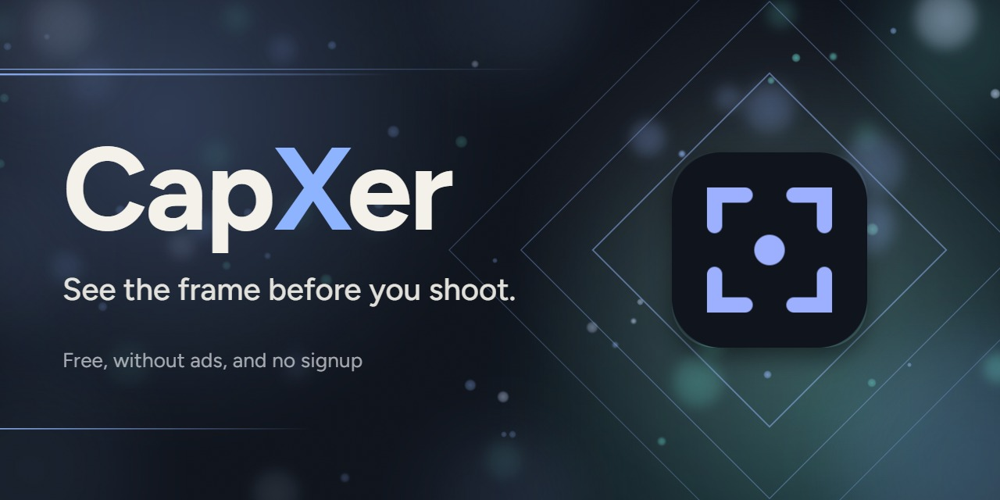

  

  

     

**CapXer** is a director's viewfinder in your browser. Pick a sensor or film format, an aspect ratio and a focal length, and see exactly what the lens frames.

It also has a live camera view for checking framing on location, a small 3D lab where aperture, shutter, ISO and white balance change the picture like a real camera, and short lessons on aspect ratios, focal length and composition, with every fact linked to its source. It works offline once installed, and your camera feed never leaves your device.

Under the hood, it is built with Astro and Svelte, with Three.js (through Threlte) drawing the 3D lab. It is a progressive web app, so it installs on your phone or computer, and an automated test suite that includes accessibility checks covers it.

## License and credits

The code is released under the [KFA Source-Available License 1.0](LICENSE). It is **source-available, not open source**: you can read it, fork it and run it privately, but deploying it, modifying it and commercial use need written permission.

Third-party software, data and media are credited in [THIRD_PARTY.md](THIRD_PARTY.md).

---

© 2026 Kiarash Farajzadehahary.

Made with ❤️ for directors and art students.
